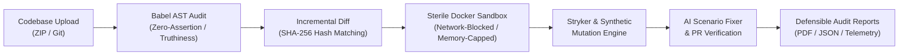

# 🛡️ TestTruth

<div align="center">

[](LICENSE)
[](https://www.typescriptlang.org/)
[](https://react.dev/)
[](https://nodejs.org/)
[](https://vitejs.dev/)
[](https://tailwindcss.com/)
[](https://www.framer.com/motion/)

<p align="center">
  <strong>An empirical auditing SaaS that proves whether your JavaScript & TypeScript tests actually catch bugs.</strong>
  <br />
  <em>Unmask false confidence, detect zero-assertion tests, and inject synthetic mutations inside sterile sandboxes.</em>
</p>

[**Explore Live Demo**](http://localhost:3000) • [**Deployment Guide**](DEPLOYMENT.md) • [**Methodology**](http://localhost:3000/methodology) • [**Report a Bug**](https://github.com/Sejalsoni30/TestTruth/issues)

</div>

---

## ⚡ The Problem: 100% Green Tests, 0% Confidence

With the rise of AI code assistants (GitHub Copilot, Cursor, Claude), developers are writing more tests than ever before. **However, code coverage only proves that lines were executed — not that logic was verified.**

| The Illusion (Standard Code Coverage) | The Truth (TestTruth Mutation Audit) |
|---|---|
| A test executes 100 lines of code with zero `expect()` assertions. | **100% Line Coverage achieved** — yet it catches 0 bugs. |
| A test passes with shallow truthiness: `expect(user).toBeDefined()`. | Logic breaks completely, but `user` remains defined. Test still passes green. |
| A test checks discount calculation with a hardcoded mock where `tax = 0`. | An inverted operator (`+` changed to `-`) still passes undetected. |

**TestTruth solves this by deliberately mutating your code and testing your test suite.** If your tests do not fail when a bug is introduced, your tests are weak.

---

## 🚀 Key Features



### 1. 🧬 Isolated Mutation Testing Matrix
- Injects synthetic code defects: **Relational Operator Inversion** (`>=` to `>`), **Logical Negation** (`&&` to `||`), **Arithmetic Swapping** (`+` to `-`), and **Return Nullification**.
- Tests run inside sterile, network-isolated sandboxes with hard timeouts and strict memory limits.
- If the test suite fails, the mutant is **KILLED** (strong test). If the suite passes, the mutant has **SURVIVED** (blind spot detected).

### 2. 🔍 AST Assertion Auditing (Tree-sitter & Babel)
- Analyzes Abstract Syntax Trees to flag:
  - **Run-Only Tests:** Tests with zero assertions that only execute code without verification.
  - **Shallow Truthiness:** Over-reliance on `toBeTruthy()` and `toBeDefined()` rather than exact state assertions.
  - **Tautological Assertions:** Useless checks like `expect(true).toBe(true)`.

### 3. ⚡ Incremental Mutation Runs (Fast Re-audits)
- Computes SHA-256 hashes for every source file.
- Re-running an audit only mutates files that actually changed, caching and reusing results for unchanged files to deliver lightning-fast verification.

### 4. 🤖 AI-Suggested Test Fixes with Sandbox Verification
- Identifies surviving mutants and synthesizes targeted reproduction unit tests.
- Re-runs the sandbox on a temporary branch to mathematically confirm: *"Mutant now killed with 0 escapes"*.

### 5. 📊 Defensible Audit Reports (PDF & JSON)
- Generates downloadable, audit-ready compliance reports (PDF and structured JSON) for SOC2, compliance, or team lead reviews.

### 6. ✨ MotionSites.ai Interactive Experience
- Built with **Framer Motion**:
  - **Floating Glassmorphic Navbar:** Responsive pill cockpit with quick navigation and live indicators.
  - **Live Interactive Sandbox Simulator:** Hands-on playground to toggle mutant operators and watch the test runner sweep across in real time.
  - **Test Sensitivity Calculator:** Interactive sliders to forecast false confidence rates based on test suite size and mocking ratio.
  - **Cursor-Tracking Spotlight Cards:** Dynamic radial glow effects tracking cursor movement.

---

## 💻 Tech Stack

- **Frontend:** React 18, TypeScript, Vite, Tailwind CSS, Framer Motion, Recharts, Lucide Icons, jsPDF.
- **Backend:** Node.js, Express, TypeScript, Babel AST Parser (`@babel/parser`, `@babel/traverse`), Zod, Helmet.
- **Database:** MongoDB with Mongoose (featuring automatic `mongodb-memory-server` fallback for zero-friction setup without installing local MongoDB).
- **Security:** Zip-slip mitigation, sterile sandbox isolation (no network egress, zero host credentials leaked, timeout watchdogs).

---

## 🏁 Quick Start (Runs in 60 Seconds)

### Prerequisites
- [Node.js](https://nodejs.org/) >= 20.x
- [npm](https://www.npmjs.com/) >= 10.x
- *(Optional)* [Docker](https://www.docker.com/) for containerized test runs.

### 1. Clone & Install
```bash
git clone https://github.com/Sejalsoni30/TestTruth.git
cd TestTruth
npm install
```

### 2. Start Everything with One Command
```bash
npm run dev
```

This single command starts:
- 🌐 **Frontend Application:** `http://localhost:3000`
- ⚙️ **Backend API Server:** `http://localhost:5000`
- 🗄️ **Zero-Config Database:** Automatically initializes MongoDB Memory Server and seeds the starter project with live mutation results!

---

## 🔑 Pre-Seeded Login Accounts

Both evaluation accounts are initialized automatically on first launch:

| Email | Password | Role | Features |
|---|---|---|---|
| **`user@gmail.com`** | `Password123!` *(or any)* | Member | Pre-seeded with *Weak Calculator* audit suite |
| **`demo@testtruth.io`** | `Password123!` | Demo Lead | Administrative evaluation workspace |

*(You can also click **"Explore Demo Workspace (1-Click)"** on the login page to enter immediately without typing credentials).*

---

## 📁 Repository Structure

```
TestTruth/
├── backend/                  # Node.js + Express TypeScript API
│   ├── src/
│   │   ├── config/           # Environment & in-memory/external DB config
│   │   ├── controllers/      # Auth, Projects, Runs, Contact controllers
│   │   ├── models/           # Mongoose schemas (User, Project, Run, Finding)
│   │   ├── services/
│   │   │   ├── analysisPipelineService.ts  # Core audit pipeline
│   │   │   ├── mutationEngine.ts           # AST mutation injection
│   │   │   ├── sandboxRunner.ts            # Sterile execution runner
│   │   │   ├── fileHashService.ts          # Incremental SHA-256 caching
│   │   │   └── weakAssertionAnalyzer.ts    # Babel AST assertion checker
│   │   └── index.ts          # Express server entry point
│   └── Dockerfile            # Container build for backend
│
├── frontend/                 # React 18 + Vite + Tailwind + Framer Motion
│   ├── src/
│   │   ├── components/
│   │   │   ├── common/       # PublicNavbar, Footer, Button, Card, Badge, Modal
│   │   │   └── motion/       # InteractiveMutantSimulator, Calculator, SpotlightCard
│   │   ├── pages/            # Landing, Pricing, Dashboard, Reports, Login, Docs
│   │   ├── context/          # AuthContext, ProjectContext, ThemeContext
│   │   └── services/         # API client layer (authService, runService)
│   └── vite.config.ts        # Vite build & API reverse-proxy config
│
├── samples/
│   └── weak-calculator/      # Deliberately weak JS test suite for verification
│
├── render.yaml               # 1-Click Render blueprint
├── vercel.json               # Vercel SPA routing configuration
├── netlify.toml              # Netlify build configuration
├── docker-compose.yml        # Docker deployment composition
└── DEPLOYMENT.md             # Complete step-by-step production deployment guide
```

---

## 📡 REST API Reference

| Method | Endpoint | Description | Auth Required |
|---|---|---|---|
| `POST` | `/api/auth/login` | Authenticate or auto-provision evaluation user | No |
| `POST` | `/api/auth/register` | Register new account and seed starter workspace | No |
| `POST` | `/api/auth/demo` | 1-Click Demo Lead sign-in | No |
| `GET` | `/api/projects` | List projects for logged-in user | Bearer JWT |
| `POST` | `/api/projects/upload` | Upload ZIP codebase (with Zip-slip protection) | Bearer JWT |
| `POST` | `/api/runs/start` | Trigger full or incremental mutation audit | Bearer JWT |
| `GET` | `/api/runs/dashboard-metrics` | Telemetry metrics, kill rates & recent runs | Bearer JWT |
| `GET` | `/api/runs/:runId/export-json`| Download complete reproducible JSON report | Bearer JWT |
| `POST` | `/api/contact` | Submit inquiry / enterprise demo request | No |

---

## 🚢 Production Deployment

TestTruth is ready to deploy to your platform of choice:

- **Vercel (Frontend):** Connect `Sejalsoni30/TestTruth` on [Vercel](https://vercel.com/new), set root directory to `frontend`.
- **Render (Full-Stack Blueprint):** Connect the repo on [Render](https://render.com) using the pre-configured `render.yaml`.
- **Railway (Full-Stack):** Connect the repo on [Railway](https://railway.com) using `backend/Dockerfile`.
- **Docker Compose:** Run `docker compose up -d` on any Linux VPS.

*See [DEPLOYMENT.md](DEPLOYMENT.md) for full step-by-step instructions.*

---

## 📜 The Non-Negotiable Honesty Principle

1. **No Absolute Claims:** TestTruth will never claim a test suite is *"100% bug-free"* or *"fully reliable"*. 
2. **Surviving Mutants are Clues, Not Proof:** A surviving mutant indicates a lack of test sensitivity to that specific code modification; human business logic remains vital.
3. **No Blended Vanity Scores:** We report exact counts (Killed, Survived, Weak Assertions, Escaped Branches) rather than combining unrelated metrics into a deceptive overall percentage.

---

## 📄 License

Distributed under the **MIT License**. See `LICENSE` for more information.
Built for engineering teams, QA leaders, and researchers seeking empirical test suite truth.
